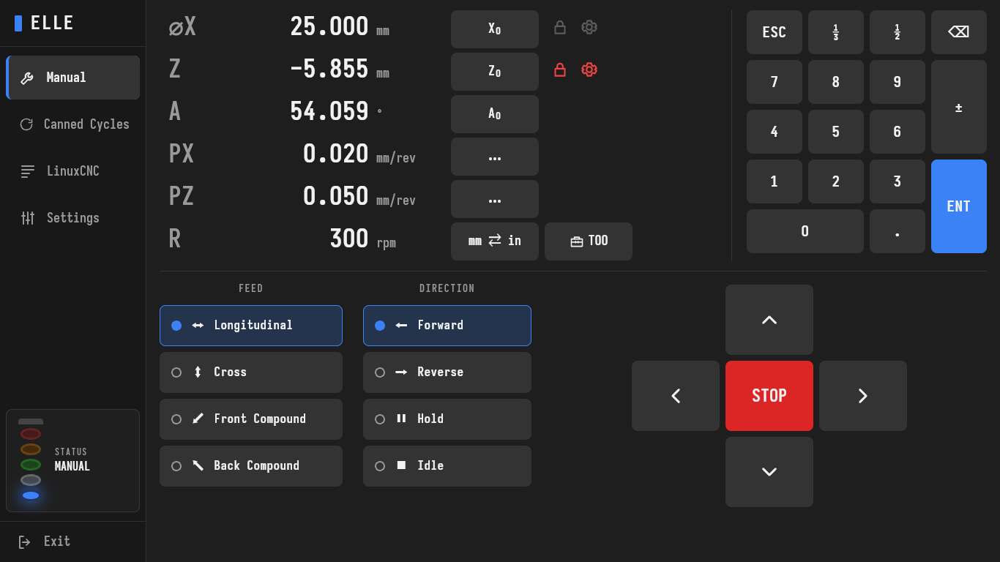
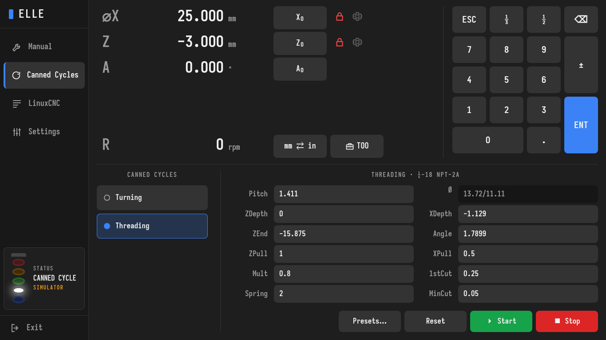
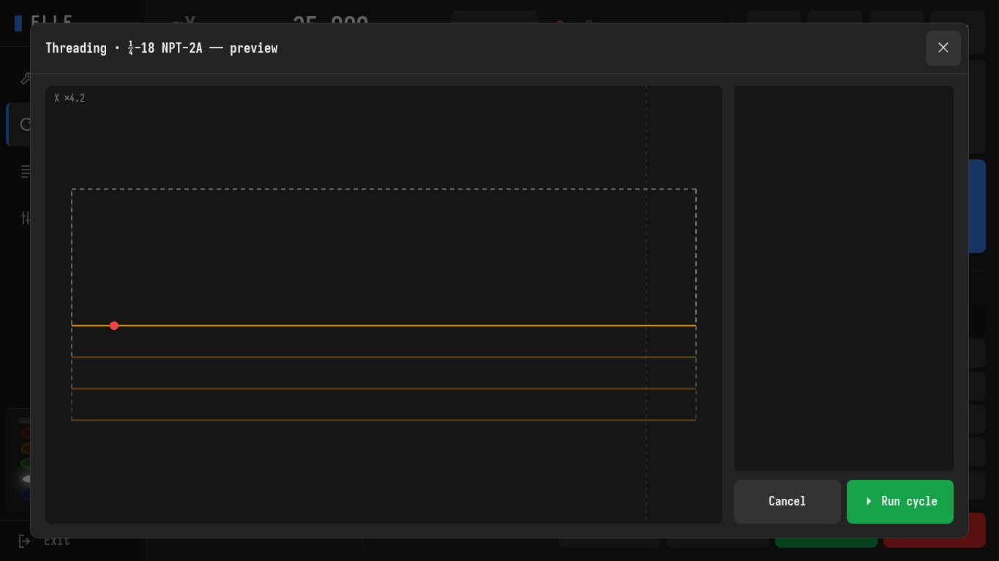

# Elle

Electronic leadscrew and canned cycles for CNC-converted lathes, on LinuxCNC. Elle brings manual
lathe work back to a converted machine: a touch-screen DRO, the leadscrew geared to the spindle
in any feed direction, jogging, and threading and turning cycles with a preview.

The machine must have stepper drivers with enable inputs wired, linear encoders on X and Z, and a
spindle encoder.





## How it fits together

```
LinuxCNC ── starts ──▶ elle  (DISPLAY program, C++23)
                        ├─ HAL component "lathe"   pins wired by machine/lathe.hal + postgui.hal
                        ├─ 100 Hz control loop     leadscrew gearing, jog with dead-man, DRO
                        ├─ task worker (NML)       runs cycles as MDI subroutine calls
                        └─ WebKitGTK window ─────▶ operator panel (ui/, Vue + TypeScript)
```

LinuxCNC runs `elle` as its `DISPLAY` program, so starting LinuxCNC starts the panel and closing
the panel shuts LinuxCNC down. The panel talks to `elle` inside the process; nothing listens on
the network.

| Directory  | Contents |
|------------|----------|
| `backend/` | C++23: `core` (cycles, controller, validation; no I/O), `linuxcnc` (HAL and NML adapters), `app` (protocol, session, settings), `shell` (the `elle` executable) |
| `ui/`      | The operator panel; runs standalone in a browser with a built-in simulator |
| `machine/` | LinuxCNC configuration: `lathe.ini`, `lathe.hal`, `postgui.hal`, `tools.tbl` |

## Building

Requirements: GCC 16 (`tools/build-gcc16.sh` builds it into `~/.local/gcc-16`; `bootstrap.sh`
installs everything else), CMake 4, Ninja, Node 22, LinuxCNC 2.9+ with `linuxcnc-uspace-dev`, and
`libwebkit2gtk-4.1-dev`. The static analyzers (clang-tidy 19, cppcheck, include-what-you-use)
are optional for development builds and required by the `analyze` preset.

```sh
cd ui && npm ci && npm run build && cd ..
cd backend
cmake --preset dev && cmake --build --preset dev && ctest --preset dev
for p in analyze dev tsan release; do cmake --workflow --preset check-$p; done
cmake --preset release && cmake --build --preset release
cpack --config build/release/CPackConfig.cmake      # elle_<version>_amd64.deb
```

The presets expect GCC at `~/.local/gcc-16/bin/g++-16`; edit `CMakePresets.json` if yours lives
elsewhere.

Every GCC warning that applies is enabled and is an error, clang-tidy runs with all checks
(exclusions are listed with reasons in `.clang-tidy`), and cppcheck runs with `--enable=all`.
Debug builds use the checked libstdc++ with AddressSanitizer and UndefinedBehaviorSanitizer.

## Running

- **On the lathe:** install the package, copy `/usr/share/elle/machine` to your configuration
  directory, adapt `lathe.hal` to your hardware and start `linuxcnc lathe.ini`.
- **Anywhere, without a machine:** `elle --demo --windowed` runs the real C++ stack against a
  simulated lathe.
- **Panel development:** `cd ui && npm run dev` serves the panel with hot reload. Open it in a
  browser to use the simulator, or run `elle --demo --dev-url http://127.0.0.1:5173/`.

Settings live in `~/.config/elle/settings.json`. The first start imports the tool table and
preferences from the previous Electron version.

## Cycles

Threading and turning G-code is generated in `backend/src/core`. `backend/test/golden/` pins the
output to the original implementation for every shipped preset; see the README there for how it
was produced and for every intended difference.
